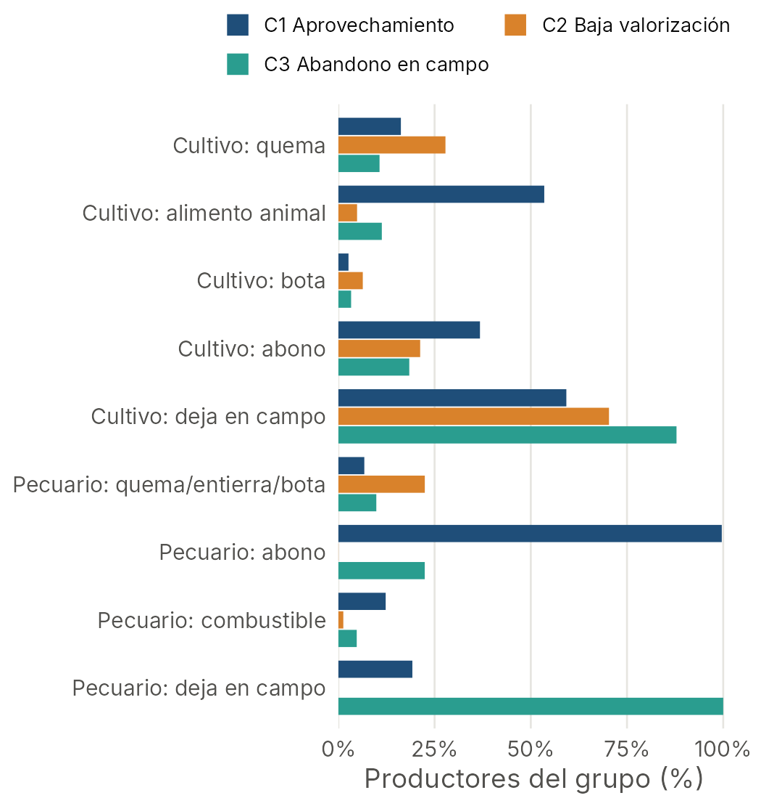
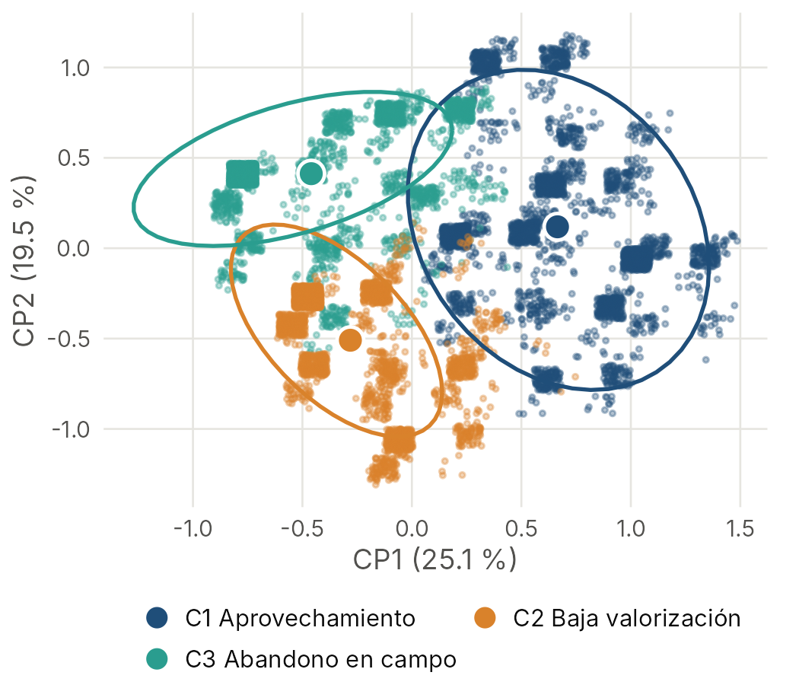

<div align="center">

# Gestión de residuos agrícolas y pecuarios en el Perú

### Una tipología de productores mediante análisis de conglomerados (ENA 2016–2025)

[](https://www.r-project.org/)
[](https://github.com/Anyell0w/gestion_residuos_agricolas_ena/actions/workflows/pipeline.yml)
[](https://doi.org/10.5281/zenodo.24371365)
[](LICENSE)
[](LICENSE-DATA)

**Angello Marcelo Zamora Valencia · Ronaldo Carlos Mamani Mena · Lizbeth Estefany Cáceres Tacora · Tania Karin Butrón Maquera**
Escuela Profesional de Ingeniería Estadística e Informática — Universidad Nacional del Altiplano, Puno, Perú

</div>

---

## Resumen

Este repositorio contiene los datos, el código en R y la fuente LaTeX del artículo *“Gestión de residuos agrícolas y pecuarios en el Perú: una tipología de productores mediante análisis de conglomerados”* (estructura IEEE).

A partir del Capítulo 600 de la **Encuesta Nacional Agropecuaria (ENA)** del INEI se analizan **244 609 pequeños y medianos productores (2016–2025)** caracterizados por **9 prácticas de manejo de rastrojos y estiércol**; otras 6 variables (almacenamiento de alimentos, minería cercana, información estatal, trazabilidad y certificación) se usan para describir los grupos. Con k-means, contrastado con Ward y CLARA, se identifican **3 perfiles estables** (ARI bootstrap = 0.846):

| Perfil | % | Rasgo distintivo | Región donde predomina |
|---|---:|---|---|
| **C1 Aprovechamiento** | 35.9 | Estiércol como abono (100 %), rastrojos como alimento animal (53 %) | Sierra (52 % de sus productores) |
| **C2 Baja valorización** | 33.3 | No usa el estiércol; concentra la quema (28 %) y la eliminación inadecuada (22 %) | Costa (63 %) |
| **C3 Abandono en campo** | 30.8 | Deja estiércol (100 %) y rastrojos (88 %) en la parcela | Selva (56 %) |

<p align="center">
  
  
</p>

## Flujo de trabajo

```mermaid
flowchart LR
    RAW[("CSV ENA<br/>306 966 × 47")] --> S1
    subgraph A["Preparación de los datos"]
      S1["1 · Lectura por bloques<br/>01_ingest.R"] --> S2["2 · Depuración y<br/>armonización 2016–2025<br/>02_clean.R"]
      S2 --> S3["3 · 9 variables activas<br/>+ 6 ilustrativas<br/>03_features.R"] --> S4["4 · Normalización y<br/>combinaciones únicas<br/>04_normalize.R"]
    end
    subgraph B["Análisis de conglomerados"]
      S5["5 · Número de grupos<br/>05_select_k.R"] --> S6["6 · k-means · Ward · CLARA<br/>06_cluster.R"]
      S6 --> S7["7 · Silueta, ARI, Jaccard<br/>07_validate.R"] --> S8["8 · Perfiles, χ², ACP<br/>08_profile.R"]
    end
    S4 --> S5
    S8 --> S9["9–10 · Figuras y tablas<br/>09_figures.R · 10_tables.R"]
    S9 --> PDF[["paper/main.pdf"]]
```



| Etapa | Script | Salida principal |
|---|---|---|
| 1 | `R/01_ingest.R` | `01_ingest.rds`, `ingest_audit.csv` (MD5, filas, memoria) |
| 2 | `R/02_clean.R` | `02_clean.rds`, `flujo_depuracion.csv`, `armonizacion_anual.csv` |
| 3 | `R/03_features.R` | `03_features.rds`, `ena_cap600_15var.csv.gz`, `descriptivos_15var.csv` |
| 4 | `R/04_normalize.R` | `04_matrices.rds` (min–max, z, 446 combinaciones únicas) |
| 5 | `R/05_select_k.R` | `seleccion_k.csv` (codo, silueta, CH, DB, gap, ARI) |
| 6 | `R/06_cluster.R` | `clusters.rds`, `concordancia_ari.csv` |
| 7 | `R/07_validate.R` | `validacion_por_cluster.csv`, `validacion_global.csv` |
| 8 | `R/08_profile.R` | `perfil_*.csv`, `ena_cap600_clusters.csv.gz` |
| 9 | `R/09_figures.R` | `outputs/figures/*.pdf` y `*.png` |
| 10 | `R/10_tables.R` | `paper/tables/*.tex`, `numeros.tex` (cifras del texto) |

Todos los parámetros (rutas, semilla `2026`, rejilla de *k*, réplicas bootstrap, regla de decisión, años excluidos, nombres de los grupos) están en [`config/config.yml`](config/config.yml).

## Cómo ejecutarlo

**Local (R ≥ 4.3):**

```bash
git clone https://github.com/Anyell0w/gestion_residuos_agricolas_ena.git
cd gestion_residuos_agricolas_ena
Rscript install_packages.R      # instala las dependencias
make all                        # análisis completo + PDF del artículo (~5 min)
```

| Comando | Acción |
|---|---|
| `make data` | descarga el CSV desde Zenodo si no está en `data/raw/` |
| `make pipeline` | ejecuta las 10 etapas (`Rscript run_pipeline.R`) |
| `Rscript run_pipeline.R 5 10` | ejecuta solo las etapas 5 a 10 |
| `make paper` | compila `paper/main.pdf` |
| `make zenodo` | prepara en `zenodo/upload/` los archivos para Zenodo |

**Docker:** `docker build -t ena-cap600 . && docker run --rm -v "$PWD":/work ena-cap600 make all`

**GitHub Actions:** cada *push* ejecuta [`pipeline.yml`](.github/workflows/pipeline.yml) y publica el PDF, las figuras y las tablas como artefactos.

## Estructura

```
gestion_residuos_agricolas_ena/
├── R/                     # 10 etapas + utils.R (funciones, paleta, índices)
├── config/config.yml      # parámetros centralizados
├── data/
│   ├── raw/               # CSV original de la ENA (también en Zenodo)
│   ├── dictionary/        # diccionario del Capítulo 600
│   └── processed/         # archivos intermedios (se regeneran)
├── outputs/
│   ├── figures/           # PDF vectorial + PNG 300 ppp
│   ├── tables/            # resultados en CSV
│   └── models/            # objetos de modelos (se regeneran)
├── paper/                 # main.tex, references.bib, figures/, tables/
├── zenodo/                # metadatos y README del registro de datos
├── docs/                  # diccionario de variables y guía de Zenodo
├── scripts/               # download_data.sh, set_doi.sh, build_zenodo_bundle.sh
├── run_pipeline.R · install_packages.R · Makefile · Dockerfile
└── CITATION.cff · .zenodo.json · LICENSE · LICENSE-DATA
```

## Datos

* **Fuente:** INEI, Encuesta Nacional Agropecuaria, Capítulo 600 (microdatos públicos: <https://proyectos.inei.gob.pe/microdatos/>).
* **Periodo analizado:** 2016–2025. Las ediciones 2014–2015 se excluyen porque sus opciones de respuesta sobre residuos no son comparables; no hubo encuesta en 2020–2021.
* **Alcance:** pequeños y medianos productores. El extracto **no incluye factores de expansión**, por lo que los resultados describen la muestra.
* **Diccionario:** [`docs/diccionario_variables.md`](docs/diccionario_variables.md).
* **Zenodo:** <https://doi.org/10.5281/zenodo.24371365> (extracto unificado 2014–2025 y diccionario, CC BY 4.0).

## Cómo citar

**Datos:**

```bibtex
@misc{zamora2026ena_data,
  author    = {Zamora Valencia, Angello Marcelo and Butr{\'o}n Maquera, Tania Karin and
               C{\'a}ceres Tacora, Lizbeth Estefany and Mamani Mena, Ronaldo Carlos},
  title     = {Peruvian National Agricultural Survey (ENA), Chapter 600: Unified Dataset
               on Agricultural and Livestock Waste Management Practices, 2014--2025},
  year      = {2026},
  publisher = {Zenodo},
  version   = {v1},
  doi       = {10.5281/zenodo.24371365}
}
```

**Código:**

```bibtex
@misc{zamora2026ena_code,
  author       = {Zamora Valencia, Angello Marcelo and Mamani Mena, Ronaldo Carlos and
                  C{\'a}ceres Tacora, Lizbeth Estefany and Butr{\'o}n Maquera, Tania Karin},
  title        = {gestion\_residuos\_agricolas\_ena: código en R para la tipología
                  de gestión de residuos agropecuarios (ENA, Perú)},
  year         = {2026},
  howpublished = {\url{https://github.com/Anyell0w/gestion_residuos_agricolas_ena}}
}
```

También puede usar el botón **“Cite this repository”** de GitHub, que lee [`CITATION.cff`](CITATION.cff).

## Licencia

Código: [MIT](LICENSE). Datos derivados y figuras: [CC BY 4.0](LICENSE-DATA). Los microdatos originales pertenecen al INEI; cite la fuente al reutilizarlos.
